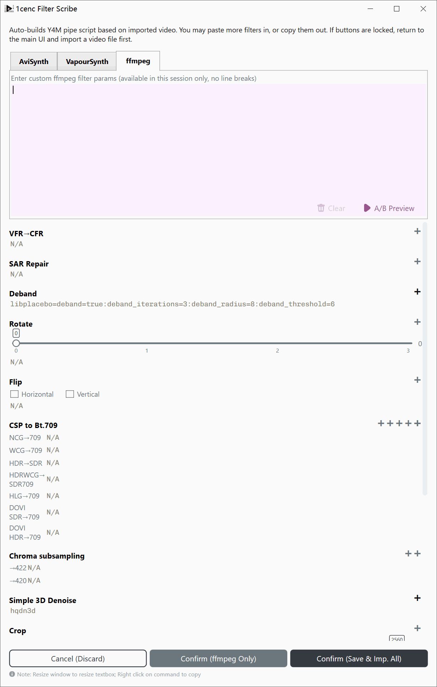
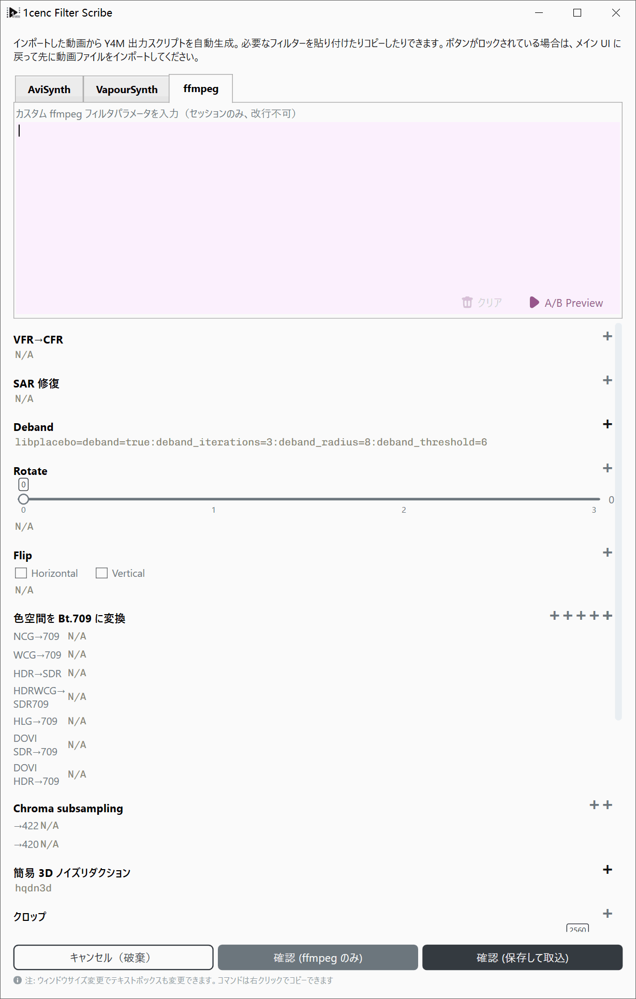
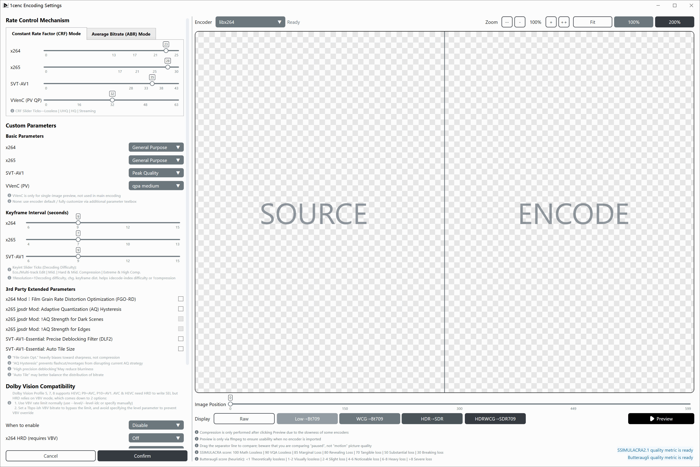

# 1cenc Professional Workflow Tutorial

This document breaks down settings and general principles in video filtering and encoding worflow and settings.

---

## Types of Compression
* **Uncompressed (Raw):** Video data is stored exactly as captured. Files are massive, demanding immense storage and high read/write speeds, but require virtually no computer power to play back.
* **Lossless Compression:** Reduces file size without losing a single pixel of data (similar to `.zip` or `.7z` archives). Files remain very large, and playback requires moderate CPU power.
* **Lossy Compression:** Permanently discards redundant or imperceptible visual details to drastically shrink file size.
  * **High Quality:** Retains more details, closer to the original.
  * **Low Quality:** Drops more data, resulting in smaller files but lower visual fidelity and reduced playback decoding requirements.

* **Bitrate:** The amount of data processed per second, measured in bits per second (b/s, Kb/s, Mb/s, Gb/s).

---

## Video Formats & Codecs

* **AVC / H.264 (`x264`):** Released in 2003, this is the most universally supported video standard. It remains a gold standard because faster codecs lack its compatibility, while higher-compression codecs are significantly slower to encode.
* **HEVC / H.265 (`x265`):** Released in 2013, an upgraded version of AVC. It offers much higher compression efficiency but demands heavy CPU resources during encoding.
* **AV1 (`SVT-AV1`, `AV1AN`, etc.):** Released in 2018 based on Google's technology. It consistently beats HEVC in compression efficiency (especially for animations). However, older mobile phones and hardware lack native decoding support.

### Common Color Spaces

| Color Space | Components | Characteristics | Purpose | Support Range |
| --- | --- | --- | --- | --- |
| **RGB** | Red, Green, Blue | General-purpose color representation | Universal for displays and cameras | Recording, Displaying |
| **ARGB** | Alpha, Red, Green, Blue | Includes a transparency channel | Facilitates layered editing | Editing, Storage |
| **CMYK** | Cyan, Magenta, Yellow, Black | Subtractive color model | Reduces ink usage in dark/colored prints | Printing |
| **YCbCr / YUV** | Y (Luminance), Cb/Cr (Color differences) | Optimized for Human Vision Systems (HVS) | Shrinks color resolution since human eyes are less sensitive to color detail than brightness | Storage, Playback |

---

## General Principles

### Performance and Lags
* **I/O Bottleneck:** If your internet connection or hard drive is running at 100% capacity and can't feed data fast enough, playback lags.
* **Computing Bottleneck:** If your CPU or GPU hits 100% usage, your hardware lacks the processing power to handle the task in real time.

### Garbage In, Garbage Out
* **Re-encoding:** Lossy compression introduces tiny visual artifacts. Re-encoding an already lossy video treats those artifacts as real details, compounding quality loss. Avoid re-encoding unless necessary (e.g., cutting file size in half or modernizing an obsolete codec).
* **Upscaling:** AI and static algorithms can predict missing pixels when scaling up low-resolution video, but they cannot magically recover lost detail. Always start with the highest-resolution source available.

### Color Accuracy
* Color conversions involve floating-point math and divisions, which can introduce minor inaccuracies. Standardizing to a uniform color profile (like **Bt.709**) prevents color shifting between different devices.

---

## Encoding Mechanics

### The Core Trade-Off
Encoding video, balances 3 competing factors: **Speed**, **Small File**, and **Image Clarity**. You can typically optimize for only 2 at the expense of the third.
```
   [Target]    → Bigger ←     [Target]
  Fast-quick      File      Image clarity
             ***************
              *************
      ↘       ***********       ↙
        Bad     *********     Slow
      Quality    *******    Progress
            ↖    *****    ↗
                   ***
                    *
                [Target]
               Small file
```

### Hardware vs. Software Encoding
* **Hardware Encoders (GPUs/ASICs):** Built directly into graphics cards or mobile chips for fast encoding, but offer less compression efficiency and image quality than software encoders.
* **Software Encoders (CPU-based):** Slower, but offer superior control, compression, and visual quality.

### Speed and Size Expectations
* **Encoding Speed:** Measured in **Frames Per Second (fps)**. If an encoder processes video at 2 fps, a 24 fps video will take 12 times longer to encode than its actual runtime.
* **Resolution Scaling:** Doubling a video's resolution (e.g., 1080p to 4K) quadruples (4x) the total pixel count ($4\times$), which can slow encoding by $20\times$ or more due to compounding effect from compression algorithms.

---

## Filtering Workflow





**Golden Rule:** *Repair first, stylize second, downscale last.* Never apply sharpening or downscaling before fixing noise and artifacts, or you will bake those errors into the final video.

* **Colorspace Profile Conversion:** Convert footage to **Bt.709** for standard SDR displays and predictable editing compatibility.
* **Chroma Subsampling:** Most standard videos use **4:2:0** subsampling to save bandwidth, which is fully compatible with hardware decoders and modern web players.
* **Denoise:** Removes unwanted random pixel fluctuations (sensor noise or film grain) from the source. Apply this before sharpening.
* **Crop:** Removes black letterbox/pillarbox borders or unwanted edges *before* resizing, so borders don't interfere with scaling algorithms.
* **Resize:** Alters dimensions up or down. Always perform heavy restoration and filtering at native resolution *before* downscaling.
* **Deband:** Eliminates abrupt color banding gradients (common in low-bitdepth 8-bit video) using subtle dither or noise patterns.
* **Blur & Sharpen:** Stylistic adjustments that enhance or reduce edge contrast. Apply these only after all repair filters.
* **Subtitle Burn-in:** Bakes subtitles directly into the video frames. Must be done as the final step after all resizing and filtering are complete.

---

## Encoding Modes & Presets



### CRF vs. ABR
* **Constant Rate Factor (CRF):** Focuses on maintaining a consistent visual quality level across the entire video. The bitrate fluctuates dynamically depending on scene complexity. **Recommended for general use.**
* **Average Bitrate (ABR):** Targets a strict average file size/bitrate. Useful only when you must meet a hard storage or streaming bandwidth limit.

### Basic Preset Profiles

#### x264 (`AVC`)
* **General Purpose:** Tuned for maximum compatibility and balanced speed across all source types.
* **Stock Footage:** Optimized to preserve source fidelity over aggressive compression.

#### x265 (`HEVC`)
* **General Purpose:** A reliable, balanced preset slightly slower than default settings.
* **Film / IRL Shoot:** Maximizes temporal redundancies and reference ranges for high-quality live-action video.
* **Anime:** Optimized for animation, featuring aggressive block-splitting and adaptive quantization.
* **Stress Test:** Maximizes CPU workloads to test hardware stability; use only with proper cooling and power delivery

#### SVT-AV1 (`AV1`)
* **Peak Quality:** Delivers the highest possible image fidelity for AV1 encoding.
* **High Compression:** Prioritizes smaller file sizes while maintaining strong visual quality.
* **Fast:** Disables intensive optimization passes to speed up encoding times at the cost of larger file sizes.

| EN | ZH-CN | ZH-TW | FR | ES | JA | RU | DE | KO | PT-BR |
|---|---|---|---|---|---|---|---|---|---|
| General Purpose | 通用 | 通用 | Général | General | 汎用 | Общее | Allgemein | 범용 | Propósito geral |
| Stock Footage | 剪辑素材 | 剪輯素材 | Images d'archives | Material de archivo | 素材映像 | Стоковое видео | Archivmaterial | 스톡 영상 | Material de arquivo |
| Film / IRL Shoot | 电影/实拍 | 電影/實拍 | Film / Prises de vue réelles | Cine / grabación real | 映画 / 実写 | Фильм / съемка | Film / Reale Aufnahmen | 영화/실사 촬영 | Filmagem / Cena real |
| Anime | 动画 | 動畫 | Animation | Anime | アニメ | Аниме | Anime | 애니메이션 | Anime |
| Stress Test | 压力测试 | 壓力測試 | Test de charge | Prueba de estrés | ストレステスト | Стресс-тест | Stresstest | 스트레스 테스트 | Teste de estresse |
| Peak Quality | 极致画质 | 極致畫質 | Qualité max. | Calidad máxima | 最高品質 | Макс. качество | Maximale Qualität | 최고 품질 | Qualidade máxima |
| High Compression | 优化压缩 | 優化壓縮 | Compression élevée | Alta compresión | 高圧縮 | Высокое сжатие | Hohe Kompression | 고압축 | Alta compressão |
| Fast | 优化速度 | 優化速度 | Rapide | Rápido | 高速 | Быстро | Schnell | 고속 | Rápido |