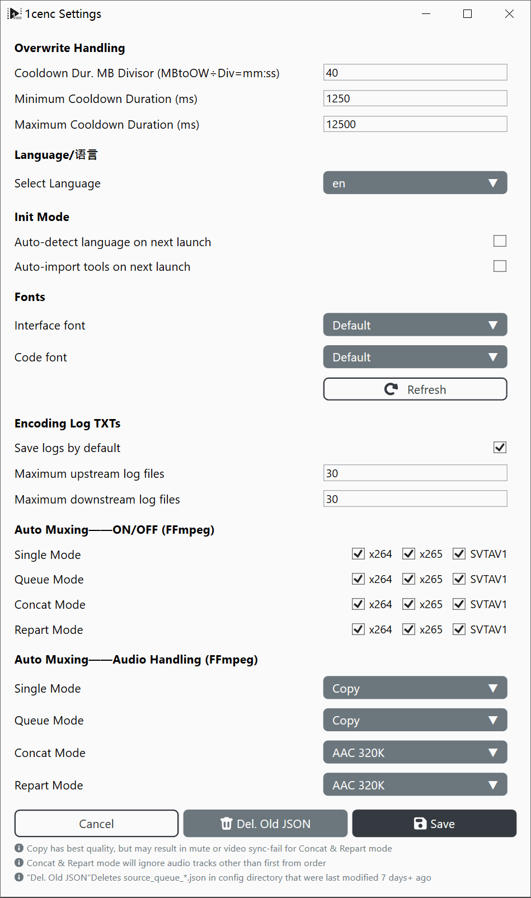

# 1cenc Professional Workflow Tutorial

This document breaks down settings and general principles in video filtering and encoding worflow and settings.

---

**Bitrate:** The amount of data processed per second, measured in bits per second (b/s, Kb/s, Mb/s, Gb/s).

## Types of Compression
* **Uncompressed (Raw):** Video data is stored exactly as captured. Files are massive, demanding immense storage and high read/write speeds, but require virtually no computer power to play back.
* **Lossless Compression:** Reduces file size without losing a single pixel of data (similar to `.zip` or `.7z` archives). Files remain very large, and playback requires moderate CPU power.
* **Lossy Compression:** Permanently discards redundant or imperceptible visual details to drastically shrink file size.
  * **High Quality:** Retains more details, closer to the original.
  * **Low Quality:** Drops more data, resulting in smaller files but lower visual fidelity and reduced playback decoding requirements.

---

## Codecs

* **AVC / H.264 (`x264`):** Standardized in 2003 and still the most widely supported video codec. Nearly every device, browser and editor can decode it, while newer codecs compress better but encode much more slowly and have patchier support.
* **HEVC / H.265 (`x265`):** Standardized in 2013 as AVC's successor. It typically needs far less bitrate than AVC for the same quality, but encoding is very CPU-intensive. Patent licensing has also held back its adoption, especially in browsers.
* **AV1 (`SVT-AV1`, `aomenc`, `rav1e`, etc.):** Released in 2018 by the Alliance for Open Media, an industry group that includes Google, and royalty-free. It generally beats HEVC in compression efficiency, especially for animation. However, older phones and other hardware lack native decoding. `AV1AN` is a chunked-encoding tool that drives these encoders, so it isn't an encoder itself.

* **AAC (`ffmpeg aac`, `QAAC`, `fdkaac`):** Standardized in 1997 and one of the most common audio formats for streaming and video. It is also one of the main Bluetooth audio codecs, though only on devices that support it, so audio is re-encoded to AAC before transmission. QAAC (Apple's encoder) has long been regarded as the best-sounding. FFmpeg 9.1 introduced a rewritten native AAC encoder. Its developer claims it outperforms qaac and fdk-aac in objective quality tests, but it is CBR-only and optimized for 48 kHz. Independent listening tests are still limited, so "best" is not yet settled.
* **Opus (`libopus`):** Standardized in 2012 as an open, royalty-free codec. It often sounds better than AAC at the same bitrate, especially at low bitrates, and is used in WebRTC, Discord, YouTube and OBS. Because it is newer, some legacy players and Adobe apps (Premiere Pro, After Effects) lack native support.

Sources:
- [FFmpeg 9.1 AAC encoder announcement thread](https://zeli.app/pt/story/48747116)
- [Doom9: Evaluation of FFmpeg 9.1 new AAC encoder](https://forum.doom9.org/archive/index.php/t-187041.html)

### Common Color Spaces

| Color Space | Components | Characteristics | Purpose | Support Range |
| --- | --- | --- | --- | --- |
| **RGB** | Red, Green, Blue | General-purpose color representation | Universal for displays and cameras | Recording, Displaying |
| **ARGB** | Alpha, Red, Green, Blue | Includes a transparency channel | Facilitates layered editing | Editing, Storage |
| **CMYK** | Cyan, Magenta, Yellow, Black | Subtractive color model | Reduces ink usage in dark/colored prints | Printing |
| **YCbCr / YUV** | Y (Luminance), Cb/Cr (Color differences) | Optimized for Human Vision Systems (HVS) | Shrinks color resolution since human eyes are less sensitive to color detail than brightness | Storage, Playback |

---

## General Principles

### Performance and Lags
* **I/O Bottleneck:** If your internet connection or hard drive is running at 100% capacity and can't feed data fast enough, playback lags.
* **Computing Bottleneck:** If your CPU or GPU hits 100% usage, your hardware lacks the processing power to handle the task in real time.

### Garbage In, Garbage Out
* **Re-encoding:** Lossy compression introduces tiny visual artifacts. Re-encoding an already lossy video treats those artifacts as real details, compounding quality loss. Avoid re-encoding unless necessary (e.g., cutting file size in half or modernizing an obsolete codec).
* **Upscaling:** AI and static algorithms can predict missing pixels when scaling up low-resolution video, but they cannot magically recover lost detail. Always start with the highest-resolution source available.

### Color Accuracy
Color conversions involve floating-point math and divisions, which can introduce minor inaccuracies. Standardizing to a uniform color profile (like **Bt.709**) prevents color shifting between different devices.

---

## Encoding Mechanics

### The Core Trade-Off
Encoding video, balances 3 competing factors: **Speed**, **Small File**, and **Image Clarity**. You can typically optimize for only 2 at the expense of the third.
```
 [Target]    → Bigger ←     [Target]
Fast-quick      File      Image clarity
           ***************
            *************
    ↘       ***********       ↙
      Bad     *********     Slow
    Quality    *******    Progress
          ↖    *****    ↗
                 ***
                  *
              [Target]
             Small file
```

### Hardware vs. Software Encoding

**Hardware Encoder (ASIC):** Uses dedicated circuits on the chip to accelerate encoding. However, chip area is limited, and ASIC codec involve trade-offs with other hardware resources. Hardware encoders may offer lower compression efficiency or image quality at the same bitrate.

**Software Encoder (CPU/GPU-based):** Uses programmable processors to execute encoding algorithms. It is generally slower than dedicated hardware encoding, but offers greater control and can achieve better quality at the same bitrate or smaller files at the same quality.

- ASIC uses dedicated circuits to process data in parallel, like reading a weight directly from a scale.
- CPU uses arithmetic logic units (ALUs) to perform calculations, like calculating weight from raw measurements.

### Speed and Size Expectations

**Encoding Speed:** Measured in **Frames Per Second (fps)**. If an encoder processes video at 2 fps, a 24 fps video will take 12 times longer to encode than its actual runtime.

**Resolution Scaling:** Doubling a video's resolution (e.g., 1080p to 4K) quadruples (4x) the total pixel count ($4\times$), which can slow encoding by $20\times$ or more due to compounding effect from compression algorithms.

---

## Filtering Workflow


**Golden Rule:** *Repair first, stylize second, downscale last.* Never apply sharpening or downscaling before fixing noise and artifacts, or you will bake those errors into the final video.

* **Colorspace Profile Conversion:** Convert footage to **Bt.709** for standard SDR displays and predictable editing compatibility.
* **Chroma Subsampling:** Most standard videos use **4:2:0** subsampling to save bandwidth, which is fully compatible with hardware decoders and modern web players.
* **Denoise:** Removes unwanted random pixel fluctuations (sensor noise or film grain) from the source. Apply this before sharpening.
* **Crop:** Removes black letterbox/pillarbox borders or unwanted edges *before* resizing, so borders don't interfere with scaling algorithms.
* **Resize:** Alters dimensions up or down. Always perform heavy restoration and filtering at native resolution *before* downscaling.
* **Deband:** Eliminates abrupt color banding gradients (common in low-bitdepth 8-bit video) using subtle dither or noise patterns.
* **Blur & Sharpen:** Stylistic adjustments that enhance or reduce edge contrast. Apply these only after all repair filters.
* **Subtitle Burn-in:** Bakes subtitles directly into the video frames. Must be done as the final step after all resizing and filtering are complete.

---

## Encoding Modes & Presets


**Constant Rate Factor (CRF):**
* Focuses on maintaining a consistent visual quality level across the entire video. The bitrate fluctuates dynamically depending on scene complexity. **Recommended for general use.**

**Average Bitrate (ABR):**
* Targets a strict average file size/bitrate. Useful only when you must meet a hard storage or streaming bandwidth limit.

> CRF and ABR modes appears in both video and audio encoders

### Basic Presets——Video

#### x264 (`AVC`)
* **General Purpose:** Tuned for maximum compatibility and balanced speed across all source types.
* **Stock Footage:** Optimized to preserve source fidelity over aggressive compression.

#### x265 (`HEVC`)
* **General Purpose:** A reliable, balanced preset slightly slower than default settings.
* **Film / IRL Shoot:** Maximizes temporal redundancies and reference ranges for high-quality live-action video.
* **Anime:** Optimized for animation, featuring aggressive block-splitting and adaptive quantization.
* **Stress Test:** Maximizes CPU workloads to test hardware stability; use only with proper cooling and power delivery

#### SVT-AV1 (`AV1`)
* **Peak Quality:** Delivers the highest possible image fidelity for AV1 encoding.
* **High Compression:** Prioritizes smaller file sizes while maintaining strong visual quality.
* **Fast:** Disables intensive optimization passes to speed up encoding times at the cost of larger file sizes.

### Audio (Auto-Mux Settings)




1cenc uses ffmpeg to encode audio, modes can be seen from source code snipet:

```csharp
/// <summary>
/// Builds the audio codec argument fragment for a resolved audio mux mode.
/// Returns null for Disable so callers can emit the bare -an instead.
/// </summary>
private static string? BuildAudioMuxArgs(EncodingAudioMuxMode mode) => mode switch
{
    EncodingAudioMuxMode.Copy => "-c:a copy",
    EncodingAudioMuxMode.ReEncodeAAC320 => "-c:a aac -b:a 320k",
    EncodingAudioMuxMode.ReEncodeAAC256 => "-c:a aac -b:a 256k",
    EncodingAudioMuxMode.ReEncodeAAC128 => "-c:a aac -b:a 128k",
    EncodingAudioMuxMode.ReEncodeOpus320 => "-c:a libopus -b:a 320k -vbr on -application audio -compression_level 10",
    EncodingAudioMuxMode.ReEncodeOpus256 => "-c:a libopus -b:a 256k -vbr on -application audio -compression_level 10",
    EncodingAudioMuxMode.ReEncodeOpus128 => "-c:a libopus -b:a 128k -vbr on -application audio -compression_level 10",
    // Separator: settings without bitrate limit, for quality-based unrestricted encoding
    EncodingAudioMuxMode.ReEncodeAACQ2 => "-c:a aac -aac_coder nmr -q:a 2", // 1-Nk
    EncodingAudioMuxMode.ReEncodeAACQ1_5 => "-c:a aac -aac_coder nmr -q:a 1.5", // 1-192k
    EncodingAudioMuxMode.ReEncodeAACQ1 => "-c:a aac -aac_coder nmr -q:a 1", // 1-140k
    EncodingAudioMuxMode.ReEncodeOpusVBR => "-c:a libopus -vbr on -application audio -compression_level 10",
    _ => null
};
```

**ReEncodeAACXXX:**
- FFmpeg AAC encoder's ABR modes
- Drops quality when the source audio is too complex to fit into average kbps limit

**ReEncodeOPUSXXX:**
- libopus encoder's ABR modes
- Drops quality when the source audio is too complex to fit into average kbps limit

**ReEncodeAACQXXX**
- FFmpeg AAC encoder's CRF modes

**ReEncodeOpusVBR**
- libopus encoder's “Auto” mode, no bitrate guidance gives as much bitrate as needed, like lossless compression

---

## Professional Workdlow Tutorial Complete

**How to Report Issues**
- You can report issues via [GitHub Issues](https://github.com/iAvoe/OneColumnEncoder/issues) or the [NazoRip comment section](https://nazorip.site/archives/1593/). Before reporting, please verify the issue is caused by 1cenc. It is best to include screenshots, runtime log copies, ffprobe logs, or other auxiliary information to aid troubleshooting.