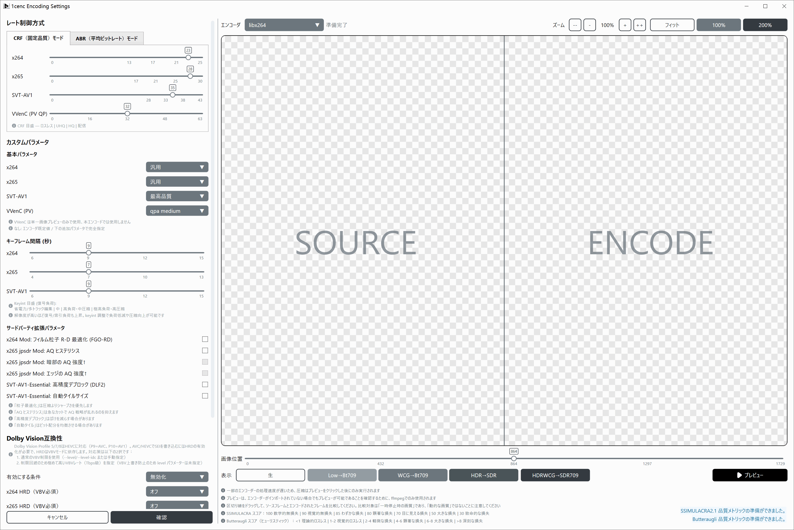
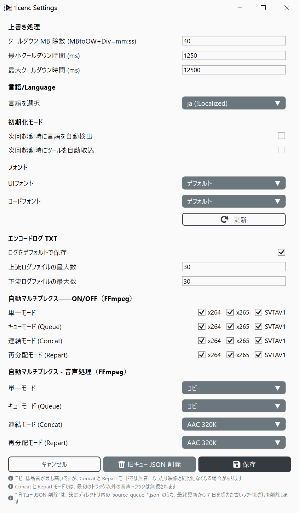

# 1cenc エキスパート向け使用ガイド

この文書では、動画のフィルタリングとエンコードワークフローにおける設定と基本原則を解説します。

---

**ビットレート：** 1 秒あたりに処理されるデータ量で、ビット毎秒（b/s、Kb/s、Mb/s、Gb/s）で測定されます。

## 圧縮の種類
* **非圧縮（Raw）：** 動画データを取得時のまま保存します。ファイルは非常に大きく、膨大なストレージと高速な読み書きが必要ですが、再生に必要なコンピューターの処理能力はほとんどありません。
* **可逆圧縮：** データのピクセルを 1 つも失わずにファイルサイズを削減します（`.zip` や `.7z` アーカイブに似ています）。ファイルは依然として非常に大きく、再生には中程度の CPU 処理能力が必要です。
* **非可逆圧縮：** 冗長または知覚しにくい視覚的な詳細を恒久的に破棄して、ファイルサイズを大幅に縮小します。
  * **高画質：** より多くの詳細を保持し、元の画質に近くなります。
  * **低画質：** より多くのデータを捨てるため、ファイルは小さくなりますが、視覚的な再現性が低下し、再生時のデコード負荷も軽減されます。

---

## コーデック

* **AVC / H.264（`x264`）：** 2003 年に規格化され、現在も最も広くサポートされている動画コーデックです。ほぼすべてのデバイス、ブラウザー、編集ソフトでデコードできるため。新しいコーデックは圧縮率が高いものの、エンコードははるかに遅く、サポートもばらばらです。
* **HEVC / H.265（`x265`）：** 2013 年に AVC の後継として規格化されました。同じ品質なら AVC よりはるかに低いビットレートで済みますが、エンコードは非常に CPU を消費します。特許ライセンスも普及を阻害しており、特にブラウザーでの対応が限定的です。
* **AV1（`SVT-AV1`、`aomenc`、`rav1e` など）：** 2018 年に Google を含む業界団体 Alliance for Open Media から公開された、ロイヤリティフリーのコーデックです。圧縮効率は一般に HEVC を上回り、アニメーションで特に顕著です。ただし、古い携帯電話などのハードウェアはネイティブデコードに対応していません。`AV1AN` はこれらのエンコーダーを駆動するチャンク分割エンコード用ツールであり、エンコーダーそのものではありません。

* **AAC（`ffmpeg aac`、`QAAC`、`fdkaac`）：** 1997 年に規格化され、ストリーミングや動画で最も一般的なオーディオ形式の一つです。Bluetooth オーディオコーデックの主要な選択肢の一つでもありますが、対応デバイスでのみ使えるため、送信前にオーディオが AAC に再エンコードされます。QAAC（Apple のエンコーダー）は長らく最高音質とされてきました。FFmpeg 9.1 ではネイティブ AAC エンコーダーが書き直されました。開発者は客観品質テストで qaac と fdk-aac を上回ると主張していますが、CBR 専用で 48 kHz 向けに最適化されています。独立したリスニングテストはまだ限られており、「最高」は未確定です。
* **Opus（`libopus`）：** 2012 年に規格化された、オープンでロイヤリティフリーのコーデックです。同じビットレートでは AAC より音が良く、特に低ビットレートで顕著で、WebRTC、Discord、YouTube、OBS などで使われています。比較的新しいため、一部の旧来のプレーヤーや Adobe アプリ（Premiere Pro、After Effects）はネイティブサポートがありません。

出典：
- [FFmpeg 9.1 AAC エンコーダー発表スレッド](https://zeli.app/pt/story/48747116)
- [Doom9: Evaluation of FFmpeg 9.1 new AAC encoder](https://forum.doom9.org/archive/index.php/t-187041.html)

### 一般的な色空間

| 色空間 | 構成要素 | 特徴 | 用途 | 対応範囲 |
| --- | --- | --- | --- | --- |
| **RGB** | Red、Green、Blue | 汎用的な色表現 | ディスプレイやカメラ向けに汎用 | 録画、表示 |
| **ARGB** | Alpha、Red、Green、Blue | 透過チャンネルを含む | レイヤー編集を容易にする | 編集、保存 |
| **CMYK** | Cyan、Magenta、Yellow、Black | 減法混色モデル | 暗い・色付き印刷でインク使用量を削減 | 印刷 |
| **YCbCr / YUV** | Y（輝度）、Cb/Cr（色差） | 人間の視覚システム（HVS）向けに最適化 | 人間の目は輝度より色の詳細に敏感でないため、色解像度を削減 | 保存、再生 |

---

## 基本原則

### パフォーマンスとラグ
* **I/O ボトルネック：** インターネット接続やハードディスクが 100% 稼働し、データを十分に速く供給できない場合、再生がラグります。
* **計算ボトルネック：** CPU や GPU が 100% 使用率に達すると、ハードウェアはタスクをリアルタイムで処理する処理能力を欠いています。

### Garbage In, Garbage Out
* **再エンコード：** 非可逆圧縮は小さな視覚的な歪みを生じさせます。すでに非可逆圧縮された動画を再エンコードすると、それらの歪みが実際の詳細として扱われ、画質劣化が累積します。必要がない限り（例：ファイルサイズを半分にする、旧式のコーデックを最新化する）再エンコードは避けてください。
* **アップスケーリング：** AI や静的なアルゴリズムは、低解像度動画を拡大する際に欠けているピクセルを予測できますが、失われた詳細を魔法的に復元することはできません。常に利用可能な最高解像度のソースから始めてください。

### 色の正確さ
色変換には浮動小数点演算や除算が含まれ、わずかな誤差が生じる可能性があります。統一された色プロファイル（**Bt.709** など）に標準化することで、異なるデバイス間での色のずれを防げます。

---

## エンコードの仕組み

### 核心的なトレードオフ
動画のエンコードは、**速度**、**ファイルサイズの小ささ**、**画像の明瞭さ**という 3 つの競合する要素のバランスを取ります。通常、残りの 1 つを犠牲にして、そのうちの 2 つだけを最適化できます。
```
[目標]     → 大きい ←       [目標]
 迅速       ファイル      画像の明瞭さ
        ***************
         *************
 ↘       ***********        ↙
   悪い    *********     低速
   品質     *******      進行
       ↖    *****     ↗
              ***
               *
            [目標]
         小さいファイル
```

### ハードウェアエンコード vs. ソフトウェアエンコード

**ハードウェアエンコーダー（ASIC）：** チップ上の専用回路でエンコードを高速化します。ただし、チップ面積には限りがあり、専用回路の搭載にはほかのハードウェアリソースとのトレードオフがあります。同じビットレートでは、圧縮効率や画質が劣る場合があります。

**ソフトウェアエンコーダー（CPU/GPU ベース）：** プログラム可能なプロセッサでエンコード処理を実行します。一般に専用ハードウェアより遅いものの、設定の自由度が高く、同じビットレートで高画質、または同じ画質で小さいファイルを実現できます。

- ASIC は専用回路で並列処理します。例：体重計の数値を直接読む。
- CPU は算術論理演算装置（ALU）で計算します。例：測定値から体重を計算する。

### 速度とサイズの目安

**エンコード速度：フレーム毎秒（fps）** で測定されます。エンコーダーが動画を 2 fps で処理する場合、24 fps の動画は実際の再生時間の 12 倍の時間がかかります。

**解像度スケーリング：** 動画の解像度を 2 倍にする（例：1080p から 4K）と、総ピクセル数は 4 倍（$4\times$）になり、圧縮アルゴリズムの累積効果により、エンコードは $20\times$ 以上遅くなる可能性があります。

---

## フィルタリングワークフロー


**黄金律：** *まず修復し、次にスタイル化し、最後にダウンスケールする。* ノイズや歪みを修正する前にシャープ化やダウンスケールを適用すると、それらのエラーが最終動画に焼き付けられてしまいます。

* **色空間プロファイル変換：** 標準の SDR ディスプレイと予測可能な編集互換性のために、フッテージを **Bt.709** に変換します。
* **クロマサブサンプリング：** ほとんどの標準動画は帯域幅を節約するために **4:2:0** サブサンプリングを使用しており、ハードウェアデコーダーや最新のウェブプレーヤーと完全に互換性があります。
* **ノイズ除去：** ソースから不必要なランダムなピクセル変動（センサーノイズやフィルムグレイン）を除去します。シャープ化の前に適用してください。
* **切り抜き：** リサイズの*前*に、黒いレターボックス／ピラーボックスの境界や不要な端を除去し、境界がスケーリングアルゴリズムに干渉しないようにします。
* **リサイズ：** 寸法を上下に変更します。重い修復やフィルタリングは、ダウンスケールの*前*に常にネイティブ解像度で行ってください。
* **バンディング除去：** 微妙なディザやノイズパターンを使用して、急激な色のバンディンググラデーション（低ビット深度の 8 ビット動画でよく見られる）を除去します。
* **ぼかしとシャープ化：** エッジコントラストを強調または低減するスタイル的な調整です。すべての修復フィルターの後にのみ適用してください。
* **字幕焼き込み：** 字幕を直接動画フレームに焼き付けます。すべてのリサイズとフィルタリングが完了した最終ステップとして行う必要があります。

---

## エンコードモードとプリセット



**Constant Rate Factor / ビットレート調整定数（CRF）：**
* 動画全体で一貫した視覚品質レベルを維持することに重点を置きます。ビットレートはシーンの複雑さに応じて動的に変動します。**一般的な使用に推奨されます。**

**Average Bitrate / 平均ビットレート（ABR）：**
* 厳密な平均ファイルサイズ／ビットレートを目標とします。ハードウェアのストレージやストリーミング帯域幅の制限を満たす必要がある場合にのみ有用です。

> CRF と ABR モードは動画コーデックとオーディオコーデックの両方に登場します

### 基本プリセット——動画

#### x264（`AVC`）
* **汎用：** すべてのソースタイプで最大限の互換性とバランスの取れた速度を実現するよう調整されています。
* **素材映像：** 積極的な圧縮よりもソースの再現性を保持するよう最適化されています。

#### x265（`HEVC`）
* **汎用：** デフォルト設定よりわずかに低速ですが、信頼性が高くバランスの取れたプリセットです。
* **映画 / 実写：** 高画質のライブアクション動画のために、時間的方向の冗長性と参照範囲を最大化します。
* **アニメ：** アニメーション向けに最適化され、積極的なブロックスプリッティングと適応的量子化を備えています。
* **ストレステスト：** ハードウェアの安定性をテストするために CPU 負荷を最大化します。適切な冷却と電源供給のもとでのみ使用してください。

#### SVT-AV1（`AV1`）
* **最高品質：** AV1 エンコードで可能な最高の画像再現性を提供します。
* **高圧縮：** 強力な視覚品質を維持しながら、より小さいファイルサイズを優先します。
* **高速：** エンコード時間を短縮するために集中的な最適化パスを無効にしますが、ファイルサイズは大きくなります。

### 音声（自動マルチプレクス設定）



1cenc は音声のエンコードに ffmpeg を使用します。各モードはソースコードのスニペットから確認できます：

```csharp
/// <summary>
/// Builds the audio codec argument fragment for a resolved audio mux mode.
/// Returns null for Disable so callers can emit the bare -an instead.
/// </summary>
private static string? BuildAudioMuxArgs(EncodingAudioMuxMode mode) => mode switch
{
    EncodingAudioMuxMode.Copy => "-c:a copy",
    EncodingAudioMuxMode.ReEncodeAAC320 => "-c:a aac -b:a 320k",
    EncodingAudioMuxMode.ReEncodeAAC256 => "-c:a aac -b:a 256k",
    EncodingAudioMuxMode.ReEncodeAAC128 => "-c:a aac -b:a 128k",
    EncodingAudioMuxMode.ReEncodeOpus320 => "-c:a libopus -b:a 320k -vbr on -application audio -compression_level 10",
    EncodingAudioMuxMode.ReEncodeOpus256 => "-c:a libopus -b:a 256k -vbr on -application audio -compression_level 10",
    EncodingAudioMuxMode.ReEncodeOpus128 => "-c:a libopus -b:a 128k -vbr on -application audio -compression_level 10",
    // Separator: settings without bitrate limit, for quality-based unrestricted encoding
    EncodingAudioMuxMode.ReEncodeAACQ2 => "-c:a aac -aac_coder nmr -q:a 2", // 1-Nk
    EncodingAudioMuxMode.ReEncodeAACQ1_5 => "-c:a aac -aac_coder nmr -q:a 1.5", // 1-192k
    EncodingAudioMuxMode.ReEncodeAACQ1 => "-c:a aac -aac_coder nmr -q:a 1", // 1-140k
    EncodingAudioMuxMode.ReEncodeOpusVBR => "-c:a libopus -vbr on -application audio -compression_level 10",
    _ => null
};
```

**ReEncodeAACXXX：**
- FFmpeg AAC エンコーダーの ABR モード
- ソース音声が複雑すぎて平均 kbps の上限に収まらない場合、品質を落とします

**ReEncodeOPUSXXX：**
- libopus エンコーダーの ABR モード
- ソース音声が複雑すぎて平均 kbps の上限に収まらない場合、品質を落とします

**ReEncodeAACQXXX**
- FFmpeg AAC エンコーダーの CRF モード

**ReEncodeOpusVBR**
- libopus エンコーダーの「自動」モード。ビットレートの指定がないため、必要に応じて十分なビットレートを割り当てます（ロスレス圧縮に近い挙動）

---

## エキスパート向け使用チュートリアル終了

**問題の報告方法**
- [GitHub Issues](https://github.com/iAvoe/OneColumnEncoder/issues) または [NazoRip プロジェクトのコメント欄](https://nazorip.site/archives/1593/) で報告できます。報告前に、問題が本当に 1cenc に起因することを確認してください。調査のため、スクリーンショット、実行ログのコピー、ffprobe ログなどの補助情報があると望ましいです。