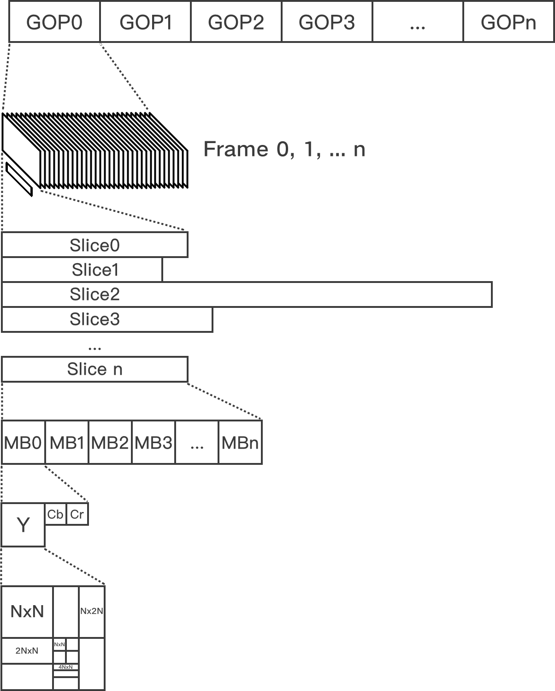
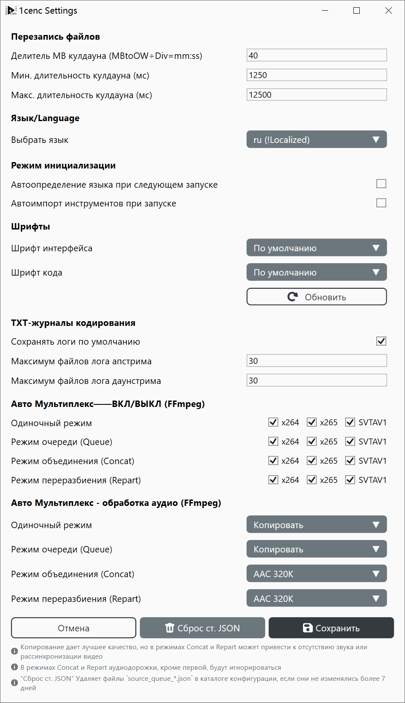

# Профессиональное руководство по рабочему процессу 1cenc

В этом документе разобраны настройки и общие принципы фильтрации и кодирования видео.

---

**Битрейт:** объём данных, обрабатываемых в секунду, измеряется в битах в секунду (бит/с, Кбит/с, Мбит/с, Гбит/с).

## Типы сжатия
**Без сжатия (Raw):** видеоданные хранятся точно так, как были получены. Файлы огромны, требуют колоссальных объёмов хранилища и высокой скорости чтения/записи, но воспроизведение практически не требует вычислительной мощности.

**Сжатие без потерь:** уменьшает размер файла, не теряя ни одного пикселя данных (аналогично архивам `.zip` или `.7z`). Файлы остаются очень большими, а воспроизведение требует умеренной мощности процессора.

**Сжатие с потерями:** безвозвратно отбрасывает избыточные или малозаметные визуальные детали, чтобы резко уменьшить размер файла.
* **Высокое качество:** сохраняет больше деталей, ближе к оригиналу.
* **Низкое качество:** отбрасывает больше данных, из-за чего файлы меньше, но визуальная точность ниже, а требования к декодированию при воспроизведении снижаются.

### Методы сжатия
**Избыточность (без потерь)**
- Сжатие: AAAAABBBC → 5(A)+3(B)+1(C)
- Распаковка/реконструкция: 5(A)+3(B)+1(C) → AAAAA+BBB+C → AAAAABBBC
- Палка о двух концах — C несжимаем: полное восстановление, но ограниченный коэффициент сжатия

**Квантование (с потерями)**
- Сжатие: 5(A)+3(B)+1(C) → отбрасываем неважные детали, например всё, что встречается только один раз → 5(A)+3(B)
- Распаковка/реконструкция: 5(A)+3(B) → … → AAAAABBB
- Палка о двух концах — C отброшен: выше коэффициент сжатия, но данные потеряны навсегда

**Сжатие видео**
- Временнáя избыточность значений пикселей (Y, Cb, Cr): например, кадры 0–5 одинаковы → записать как 5×Frame0
- Пространственная избыточность значений пикселей (Y, Cb, Cr) и квантование
- Текстовая избыточность (энтропийное кодирование): оставшиеся данные пикселей/блоков объединяются в массив и кодируются по вероятности

**Сжатие изображений**
- Пространственная избыточность значений пикселей (Y, Cb, Cr) и квантование
- Текстовая избыточность (энтропийное кодирование): оставшиеся данные пикселей/блоков объединяются в массив и кодируются по вероятности

**Сжатие текста**
- Текстовая избыточность: любой текст объединяется в последовательность символов и кодируется по вероятности
- Обычно реализуется словарным методом или методом вероятностной модели

---

## Кодеки

* **AVC / H.264 (`x264`):** Стандартизован в 2003 году и до сих пор является наиболее широко поддерживаемым видеокодеком. Почти любое устройство, браузер и монтажная программа умеют его декодировать, тогда как более новые кодеки сжимают лучше, но кодируют намного медленнее и поддерживаются неравномерно.
* **HEVC / H.265 (`x265`):** Стандартизован в 2013 году как преемник AVC. Обычно он требует куда меньшего битрейта при том же качестве, но кодирование очень ресурсоёмко. Патентные лицензии также сдерживали его распространение, особенно в браузерах.
* **AV1 (`SVT-AV1`, `aomenc`, `rav1e` и др.):** Выпущен в 2018 году альянсом Alliance for Open Media — отраслевой группой, включающей Google, — и не облагается роялти. Обычно он превосходит HEVC по эффективности сжатия, особенно в анимации. Однако старые телефоны и другое оборудование не поддерживают нативное декодирование. `AV1AN` — инструмент посекундного кодирования, управляющий этими кодировщиками, поэтому самим кодеком не является.

* **AAC (`ffmpeg aac`, `QAAC`, `fdkaac`):** Стандартизован в 1997 году и является одним из самых распространённых аудиоформатов для потоковой передачи и видео. Это также один из основных Bluetooth-аудиокодеков, но лишь на устройствах с соответствующей поддержкой, поэтому перед передачей аудио перекодируется в AAC. QAAC (кодировщик Apple) долгое время считался лучшим по звуку. В FFmpeg 9.1 появился переписанный нативный AAC-кодировщик. Его разработчик утверждает, что в объективных тестах качества он превосходит qaac и fdk-aac, однако работает только в CBR и оптимизирован под 48 кГц. Независимых прослушиваний пока мало, поэтому «лучший» не определён окончательно.
* **Opus (`libopus`):** Стандартизован в 2012 году как открытый кодек без роялти. При одинаковом битрейте часто звучит лучше AAC, особенно на низких битрейтах, и используется в WebRTC, Discord, YouTube и OBS. Поскольку он новее, некоторые старые плееры и приложения Adobe (Premiere Pro, After Effects) не имеют нативной поддержки.

Источники:
- [Тред анонса кодировщика AAC в FFmpeg 9.1](https://zeli.app/pt/story/48747116)
- [Doom9: Evaluation of FFmpeg 9.1 new AAC encoder](https://forum.doom9.org/archive/index.php/t-187041.html)

### Распространённые цветовые пространства

| Цветовое пространство | Компоненты | Характеристики | Назначение | Диапазон поддержки |
| --- | --- | --- | --- | --- |
| **RGB** | Красный, Зелёный, Синий | Универсальное представление цвета | Универсально для дисплеев и камер | Запись, Отображение |
| **ARGB** | Альфа, Красный, Зелёный, Синий | Включает канал прозрачности | Облегчает многослойный монтаж | Редактирование, Хранение |
| **CMYK** | Голубой, Пурпурный, Жёлтый, Чёрный | Субтрактивная цветовая модель | Снижает расход краски при тёмной/цветной печати | Печать |
| **YCbCr / YUV** | Y (Яркость), Cb/Cr (цветоразностные) | Оптимизировано для системы человеческого зрения (HVS) | Уменьшает цветовое разрешение, поскольку глаз человека менее чувствителен к цветным деталям, чем к яркости | Хранение, Воспроизведение |

### Распространённые структуры данных для видео
- **GOP:** Группа кадров (Group of pictures)


---

## Общие принципы

### Производительность и подтормаживания
* **Узкое место ввода-вывода:** если интернет-соединение или жёсткий диск загружены на 100% и не могут подавать данные достаточно быстро, воспроизведение тормозит.
* **Узкое место вычислений:** если процессор или видеокарта загружены на 100%, аппаратному обеспечению не хватает вычислительной мощности для обработки задачи в реальном времени.

### Garbage In, Garbage Out
* **Перекодирование:** сжатие с потерями вносит мелкие визуальные артефакты. Перекодирование уже сжатого видео воспринимает эти артефакты как реальные детали, накапливая потери качества. Избегайте перекодирования, если это не необходимо (например, сократить размер файла вдвое или модернизировать устаревший кодек).
* **Повышение разрешения:** ИИ и статические алгоритмы могут предсказать недостающие пиксели при масштабировании видео низкого разрешения, но не способны магическим образом восстановить потерянные детали. Всегда начинайте с максимально доступного исходного разрешения.

### Точность цвета
Преобразование цветов включает операции с плавающей точкой и деления, что может вносить незначительные неточности. Стандартизация на единый цветовой профиль (например, **Bt.709**) предотвращает смещение цвета между разными устройствами.

---

## Механика кодирования

### Основной компромисс
Кодирование видео балансирует между 3 конкурирующими факторами: **Скорость**, **Малый файл** и **Чёткость изображения**. Обычно можно оптимизировать лишь 2 из них в ущерб третьему.
```
[Цель]     → Больше ←      [Цель]
Быстро        Файл        Чёткость
         ***************
          *************
  ↘       ***********      ↙
   Плохое   *********  Медленно
  качество   *******   Прогресс
        ↖    *****   ↗
               ***
                *
             [Цель]
           Малый файл
```

### Аппаратное vs. программное кодирование

**Аппаратный кодировщик (ASIC):** Ускоряет кодирование с помощью специализированных схем на чипе. Однако площадь кристалла ограничена, и выделение места под эти схемы требует компромиссов в распределении аппаратных ресурсов. При одинаковом битрейте качество изображения или эффективность сжатия могут быть ниже.

**Программный кодировщик (на базе CPU/GPU):** Выполняет алгоритмы кодирования на программируемых процессорах. Обычно он медленнее специализированного аппаратного кодировщика, но предоставляет больше настроек и позволяет добиться лучшего качества при том же битрейте или меньшего размера файла при том же качестве.

- ASIC обрабатывает данные параллельно с помощью специализированных схем — как считывание показаний весов.
- CPU выполняет вычисления с помощью арифметико-логических устройств (ALU) — как расчёт веса по исходным измерениям.

### Ожидания по скорости и размеру

**Скорость кодирования:** измеряется в **кадрах в секунду (fps)**. Если кодировщик обрабатывает видео со скоростью 2 fps, то видео с частотой 24 fps будет кодироваться в 12 раз дольше его фактической продолжительности.

**Масштабирование разрешения:** удвоение разрешения видео (например, с 1080p до 4K) увеличивает общее число пикселей в четыре раза ($4\times$), что может замедлить кодирование в $20\times$ и более из-за кумулятивного эффекта алгоритмов сжатия.

---

## Процесс фильтрации


**Золотое правило:** *Сначала исправляйте, затем применяйте стилизацию, в последнюю очередь уменьшайте масштаб.* Никогда не применяйте резкость или даунскейл до устранения шума и артефактов, иначе эти ошибки запекутся в итоговом видео.

* **Преобразование цветового профиля:** преобразуйте исходный материал в **Bt.709** для стандартных SDR-дисплеев и предсказуемой совместимости при монтаже.
* **Субдискретизация цветности:** большинство стандартных видео используют субдискретизацию **4:2:0** для экономии полосы пропускания, что полностью совместимо с аппаратными декодерами и современными веб-плеерами.
* **Шумоподавление:** удаляет нежелательные случайные колебания пикселей (шум датчика или зерно плёнки) из исходника. Применяйте перед резкостью.
* **Кадрирование:** удаляет чёрные полосы летербокса/пилларбокса или нежелательные края *до* изменения размера, чтобы границы не мешали алгоритмам масштабирования.
* **Изменение размера:** изменяет размеры вверх или вниз. Всегда выполняйте серьёзное восстановление и фильтрацию в исходном разрешении *до* даунскейла.
* **Дебандинг:** устраняет резкие цветовые полосы (характерны для 8-битного видео с низкой битовой глубиной) с помощью тонкого дизеринга или шумовых паттернов.
* **Размытие и резкость:** стилистические корректировки, усиливающие или ослабляющие контраст краёв. Применяйте только после всех восстанавливающих фильтров.
* **Вжигание субтитров:** впечатывает субтитры непосредственно в кадры видео. Должно выполняться последним шагом после завершения всех изменений размера и фильтрации.

---

## Режимы и пресеты кодирования


**Constant Rate Factor / Постоянный коэффициент скорости (CRF):**
* поддерживает постоянный уровень визуального качества на протяжении всего видео. Битрейт динамически меняется в зависимости от сложности сцены. **Рекомендуется для общего использования.**

**Average Bitrate / Средний битрейт (ABR):**
* нацелен на строгий средний размер/битрейт файла. Полезен только тогда, когда необходимо соблюсти жёсткий лимит хранилища или полосы пропускания потоковой передачи.

> Режимы CRF и ABR встречаются как среди видеокодеков, так и среди аудиокодеков

### Базовые пресеты — видео

#### x264 (`AVC`)
* **Общее назначение:** настроен для максимальной совместимости и сбалансированной скорости для всех типов источников.
* **Стоковое видео:** оптимизирован для сохранения исходного качества в ущерб агрессивному сжатию.

#### x265 (`HEVC`)
* **Общее назначение:** надёжный, сбалансированный пресет, несколько медленнее настроек по умолчанию.
* **Фильм / съёмка:** максимизирует временные избыточности и диапазоны ссылок для качественного видео с реальной съёмкой.
* **Аниме:** оптимизирован для анимации с агрессивным разбиением блоков и адаптивным квантованием.
* **Стресс-тест:** максимизирует нагрузку на процессор для проверки стабильности оборудования; используйте только при надлежащем охлаждении и питании.

#### SVT-AV1 (`AV1`)
* **Макс. качество:** обеспечивает наивысшую возможную точность изображения для кодирования AV1.
* **Высокое сжатие:** отдаёт приоритет меньшему размеру файла при сохранении высокого визуального качества.
* **Быстро:** отключает ресурсоёмкие проходы оптимизации для ускорения кодирования ценой увеличения размера файла.

### Аудио (настройки автоматического мультиплексирования)



1cenc использует ffmpeg для кодирования аудио; режимы видны из фрагмента исходного кода:

```csharp
/// <summary>
/// Builds the audio codec argument fragment for a resolved audio mux mode.
/// Returns null for Disable so callers can emit the bare -an instead.
/// </summary>
private static string? BuildAudioMuxArgs(EncodingAudioMuxMode mode) => mode switch
{
    EncodingAudioMuxMode.Copy => "-c:a copy",
    EncodingAudioMuxMode.ReEncodeAAC320 => "-c:a aac -b:a 320k",
    EncodingAudioMuxMode.ReEncodeAAC256 => "-c:a aac -b:a 256k",
    EncodingAudioMuxMode.ReEncodeAAC128 => "-c:a aac -b:a 128k",
    EncodingAudioMuxMode.ReEncodeOpus320 => "-c:a libopus -b:a 320k -vbr on -application audio -compression_level 10",
    EncodingAudioMuxMode.ReEncodeOpus256 => "-c:a libopus -b:a 256k -vbr on -application audio -compression_level 10",
    EncodingAudioMuxMode.ReEncodeOpus128 => "-c:a libopus -b:a 128k -vbr on -application audio -compression_level 10",
    // Separator: settings without bitrate limit, for quality-based unrestricted encoding
    EncodingAudioMuxMode.ReEncodeAACQ2 => "-c:a aac -aac_coder nmr -q:a 2", // 1-Nk
    EncodingAudioMuxMode.ReEncodeAACQ1_5 => "-c:a aac -aac_coder nmr -q:a 1.5", // 1-192k
    EncodingAudioMuxMode.ReEncodeAACQ1 => "-c:a aac -aac_coder nmr -q:a 1", // 1-140k
    EncodingAudioMuxMode.ReEncodeOpusVBR => "-c:a libopus -vbr on -application audio -compression_level 10",
    _ => null
};
```

**ReEncodeAACXXX:**
- Режимы ABR у AAC-кодировщика FFmpeg
- Снижает качество, если исходное аудио слишком сложное, чтобы уложиться в средний лимит kbps

**ReEncodeOPUSXXX:**
- Режимы ABR у кодировщика libopus
- Снижает качество, если исходное аудио слишком сложное, чтобы уложиться в средний лимит kbps

**ReEncodeAACQXXX**
- Режимы CRF у AAC-кодировщика FFmpeg

**ReEncodeOpusVBR**
- Режим «Авто» кодировщика libopus: без указания битрейта он выделяет столько бит, сколько требуется, как при сжатии без потерь

---

## Профессиональное руководство по рабочему процессу завершено

**Как сообщить о проблеме**
- Проблемы можно отправлять через [GitHub Issues](https://github.com/iAvoe/OneColumnEncoder/issues) или [комментарии NazoRip](https://nazorip.site/archives/1593/). Перед сообщением убедитесь, что причина связана с 1cenc, и приложите скриншоты, логи выполнения и ffprobe.