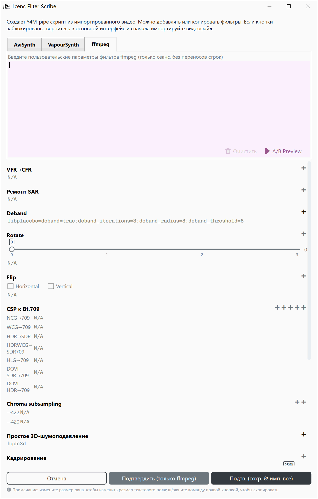
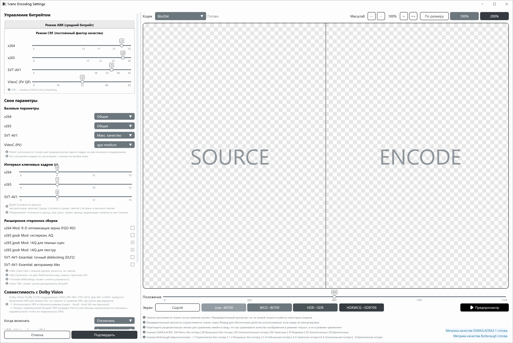

# Профессиональное руководство по рабочему процессу 1cenc

В этом документе разобраны настройки и общие принципы фильтрации и кодирования видео.

---

## Типы сжатия
* **Без сжатия (Raw):** видеоданные хранятся точно так, как были получены. Файлы огромны, требуют колоссальных объёмов хранилища и высокой скорости чтения/записи, но воспроизведение практически не требует вычислительной мощности.
* **Сжатие без потерь:** уменьшает размер файла, не теряя ни одного пикселя данных (аналогично архивам `.zip` или `.7z`). Файлы остаются очень большими, а воспроизведение требует умеренной мощности процессора.
* **Сжатие с потерями:** безвозвратно отбрасывает избыточные или малозаметные визуальные детали, чтобы резко уменьшить размер файла.
  * **Высокое качество:** сохраняет больше деталей, ближе к оригиналу.
  * **Низкое качество:** отбрасывает больше данных, из-за чего файлы меньше, но визуальная точность ниже, а требования к декодированию при воспроизведении снижаются.

* **Битрейт:** объём данных, обрабатываемых в секунду, измеряется в битах в секунду (бит/с, Кбит/с, Мбит/с, Гбит/с).

---

## Форматы и кодеки видео

* **AVC / H.264 (`x264`):** выпущен в 2003 году, наиболее универсально поддерживаемый вестандарт видео. Остаётся золотым стандартом, поскольку более быстрые кодеки уступают ему в совместимости, а более эффективные по сжатию кодеки значительно медленнее в кодировании.
* **HEVC / H.265 (`x265`):** выпущен в 2013 году, обновлённая версия AVC. Обеспечивает значительно более высокую эффективность сжатия, но требует больших ресурсов процессора при кодировании.
* **AV1 (`SVT-AV1`, `AV1AN` и др.):** выпущен в 2018 году на основе технологий Google. Стабильно превосходит HEVC по эффективности сжатия (особенно для анимации). Однако старые телефоны и аппаратное обеспечение не поддерживают нативное декодирование.

### Распространённые цветовые пространства

| Цветовое пространство | Компоненты | Характеристики | Назначение | Диапазон поддержки |
| --- | --- | --- | --- | --- |
| **RGB** | Красный, Зелёный, Синий | Универсальное представление цвета | Универсально для дисплеев и камер | Запись, Отображение |
| **ARGB** | Альфа, Красный, Зелёный, Синий | Включает канал прозрачности | Облегчает многослойный монтаж | Редактирование, Хранение |
| **CMYK** | Голубой, Пурпурный, Жёлтый, Чёрный | Субтрактивная цветовая модель | Снижает расход краски при тёмной/цветной печати | Печать |
| **YCbCr / YUV** | Y (Яркость), Cb/Cr (цветоразностные) | Оптимизировано для системы человеческого зрения (HVS) | Уменьшает цветовое разрешение, поскольку глаз человека менее чувствителен к цветным деталям, чем к яркости | Хранение, Воспроизведение |

---

## Общие принципы

### Производительность и подтормаживания
* **Узкое место ввода-вывода:** если интернет-соединение или жёсткий диск загружены на 100% и не могут подавать данные достаточно быстро, воспроизведение тормозит.
* **Узкое место вычислений:** если процессор или видеокарта загружены на 100%, аппаратному обеспечению не хватает вычислительной мощности для обработки задачи в реальном времени.

### Garbage In, Garbage Out
* **Перекодирование:** сжатие с потерями вносит мелкие визуальные артефакты. Перекодирование уже сжатого видео воспринимает эти артефакты как реальные детали, накапливая потери качества. Избегайте перекодирования, если это не необходимо (например, сократить размер файла вдвое или модернизировать устаревший кодек).
* **Повышение разрешения:** ИИ и статические алгоритмы могут предсказать недостающие пиксели при масштабировании видео низкого разрешения, но не способны магическим образом восстановить потерянные детали. Всегда начинайте с максимально доступного исходного разрешения.

### Точность цвета
* Преобразование цветов включает операции с плавающей точкой и деления, что может вносить незначительные неточности. Стандартизация на единый цветовой профиль (например, **Bt.709**) предотвращает смещение цвета между разными устройствами.

---

## Механика кодирования

### Основной компромисс
Кодирование видео балансирует между 3 конкурирующими факторами: **Скорость**, **Малый файл** и **Чёткость изображения**. Обычно можно оптимизировать лишь 2 из них в ущерб третьему.
```
[Цель]     → Больше ←      [Цель]
Быстро        Файл        Чёткость
         ***************
          *************
  ↘       ***********      ↙
   Плохое   *********  Медленно
  качество   *******   Прогресс
        ↖    *****   ↗
               ***
                *
             [Цель]
           Малый файл
```

### Аппаратное и программное кодирование
* **Аппаратные кодировщики (GPU/ASIC):** встроены непосредственно в видеокарты или мобильные чипы для быстрого кодирования, но уступают программным кодировщикам по эффективности сжатия и качеству изображения.
* **Программные кодировщики (на базе CPU):** медленнее, но обеспечивают превосходный контроль, сжатие и визуальное качество.

### Ожидания по скорости и размеру
* **Скорость кодирования:** измеряется в **кадрах в секунду (fps)**. Если кодировщик обрабатывает видео со скоростью 2 fps, то видео с частотой 24 fps будет кодироваться в 12 раз дольше его фактической продолжительности.
* **Масштабирование разрешения:** удвоение разрешения видео (например, с 1080p до 4K) увеличивает общее число пикселей в четыре раза ($4\times$), что может замедлить кодирование в $20\times$ и более из-за кумулятивного эффекта алгоритмов сжатия.

---

## Процесс фильтрации



**Золотое правило:** *Сначала исправляйте, затем применяйте стилизацию, в последнюю очередь уменьшайте масштаб.* Никогда не применяйте резкость или даунскейл до устранения шума и артефактов, иначе эти ошибки запекутся в итоговом видео.

* **Преобразование цветового профиля:** преобразуйте исходный материал в **Bt.709** для стандартных SDR-дисплеев и предсказуемой совместимости при монтаже.
* **Субдискретизация цветности:** большинство стандартных видео используют субдискретизацию **4:2:0** для экономии полосы пропускания, что полностью совместимо с аппаратными декодерами и современными веб-плеерами.
* **Шумоподавление:** удаляет нежелательные случайные колебания пикселей (шум датчика или зерно плёнки) из исходника. Применяйте перед резкостью.
* **Кадрирование:** удаляет чёрные полосы летербокса/пилларбокса или нежелательные края *до* изменения размера, чтобы границы не мешали алгоритмам масштабирования.
* **Изменение размера:** изменяет размеры вверх или вниз. Всегда выполняйте серьёзное восстановление и фильтрацию в исходном разрешении *до* даунскейла.
* **Дебандинг:** устраняет резкие цветовые полосы (характерны для 8-битного видео с низкой битовой глубиной) с помощью тонкого дизеринга или шумовых паттернов.
* **Размытие и резкость:** стилистические корректировки, усиливающие или ослабляющие контраст краёв. Применяйте только после всех восстанавливающих фильтров.
* **Вжигание субтитров:** впечатывает субтитры непосредственно в кадры видео. Должно выполняться последним шагом после завершения всех изменений размера и фильтрации.

---

## Режимы и пресеты кодирования



### CRF и ABR
* **Constant Rate Factor / Постоянный коэффициент скорости (CRF):** поддерживает постоянный уровень визуального качества на протяжении всего видео. Битрейт динамически меняется в зависимости от сложности сцены. **Рекомендуется для общего использования.**
* **Average Bitrate / Средний битрейт (ABR):** нацелен на строгий средний размер/битрейт файла. Полезен только тогда, когда необходимо соблюсти жёсткий лимит хранилища или полосы пропускания потоковой передачи.

### Базовые пресеты

#### x264 (`AVC`)
* **Общее назначение:** настроен для максимальной совместимости и сбалансированной скорости для всех типов источников.
* **Стоковое видео:** оптимизирован для сохранения исходного качества в ущерб агрессивному сжатию.

#### x265 (`HEVC`)
* **Общее назначение:** надёжный, сбалансированный пресет, несколько медленнее настроек по умолчанию.
* **Фильм / съёмка:** максимизирует временные избыточности и диапазоны ссылок для качественного видео с реальной съёмкой.
* **Аниме:** оптимизирован для анимации с агрессивным разбиением блоков и адаптивным квантованием.
* **Стресс-тест:** максимизирует нагрузку на процессор для проверки стабильности оборудования; используйте только при надлежащем охлаждении и питании.

#### SVT-AV1 (`AV1`)
* **Макс. качество:** обеспечивает наивысшую возможную точность изображения для кодирования AV1.
* **Высокое сжатие:** отдаёт приоритет меньшему размеру файла при сохранении высокого визуального качества.
* **Быстро:** отключает ресурсоёмкие проходы оптимизации для ускорения кодирования ценой увеличения размера файла.

---

## Профессиональное руководство по рабочему процессу завершено

**Как сообщить о проблеме**
- Проблемы можно отправлять через [GitHub Issues](https://github.com/iAvoe/OneColumnEncoder/issues) или [комментарии NazoRip](https://nazorip.site/archives/1593/). Перед сообщением убедитесь, что причина связана с 1cenc, и приложите скриншоты, логи выполнения и ffprobe.