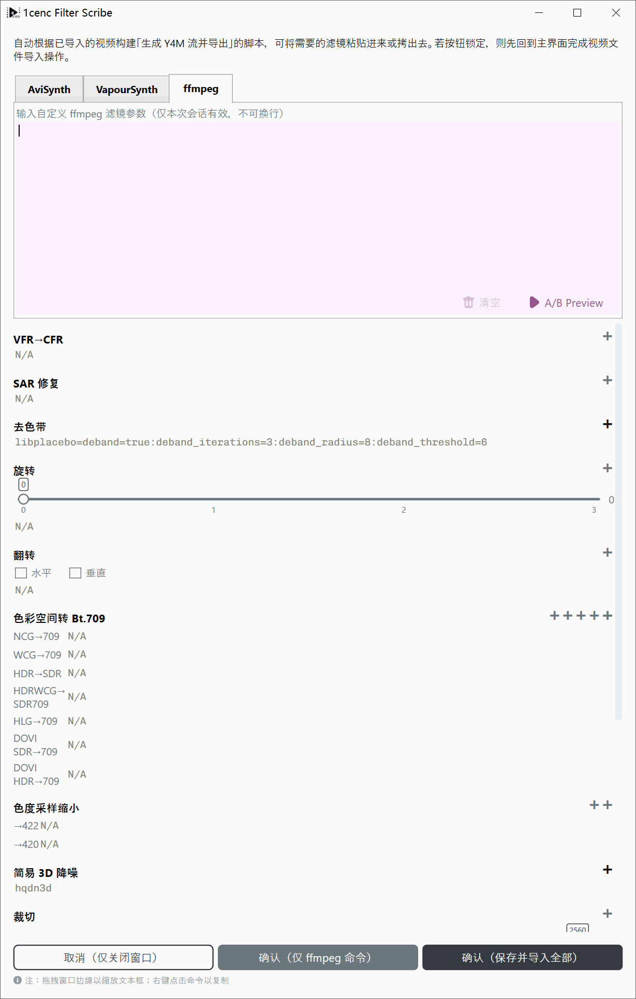
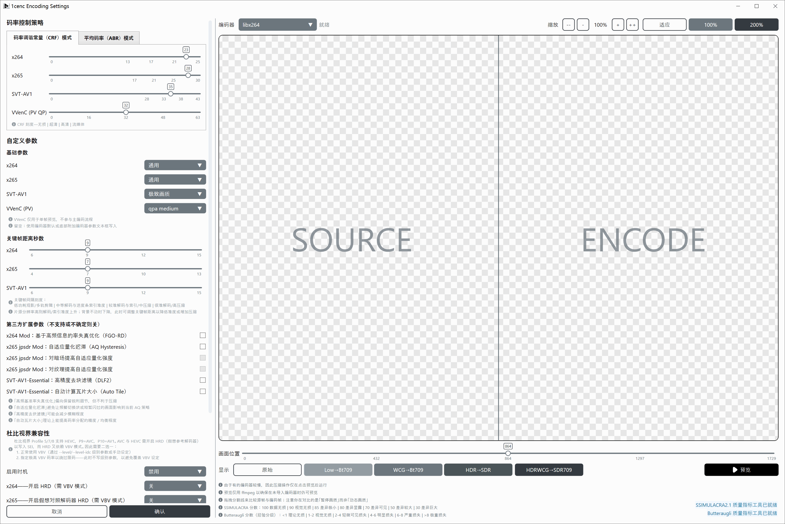
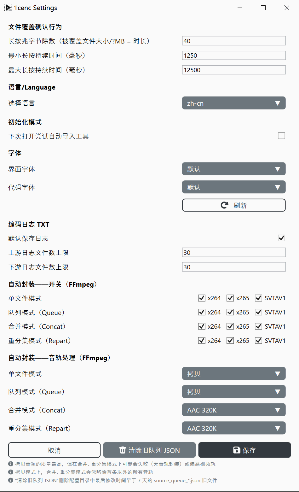

# 1cenc 专家级流程使用教程

本文档用于说明视频滤镜与压制工作流中的设置与通用原则。

---

**码率：** 每秒处理的数据量，以比特每秒（b/s、Kb/s、Mb/s、Gb/s）计量。

## 压缩类型
**未压缩（Raw）：** 视频数据原样存储。文件体积巨大，需要庞大的存储空间和极高的读写速度，但回放几乎不需要计算机算力。

**无损压缩：** 在不丢失任何像素数据的前提下减小文件体积（类似于 `.zip` 或 `.7z` 压缩包）。文件依然非常大，回放需要中等程度的 CPU 算力。

**有损压缩：** 永久丢弃冗余或难以察觉的视觉细节，以大幅缩小文件体积。
* **高质量：** 保留更多细节，更接近原始画面。
* **低质量：** 丢弃更多数据，文件更小，但视觉保真度更低，回放解码需求也更低。

### 压缩方法
**冗余（无损）**
- 压缩：AAAAABBBC → 5(A)+3(B)+1(C)
- 解压/重建：5(A)+3(B)+1(C) → AAAAA+BBB+C → AAAAABBBC
- 双刃剑——C 不可压缩：可完全还原，但压缩比有限

**量化（有损）**
- 压缩：5(A)+3(B)+1(C) → 丢掉不重要的细节，比如所有只出现 1 次的内容 → 5(A)+3(B)
- 解压/重建：5(A)+3(B) → … → AAAAABBB
- 双刃剑——C 被弃掉：压缩比更高，但永远失去数据

**视频压缩**
- 时间域像素值（Y, Cb, Cr）冗余：如帧 0–5 相同 → 记作 5×Frame0
- 空间域像素值（Y, Cb, Cr）冗余与量化
- 文本冗余（熵编码）：把剩余像素/分块数据串联为数组，按概率编码

**图像压缩**
- 空间域像素值（Y, Cb, Cr）冗余与量化
- 文本冗余（熵编码）：把剩余像素/分块数据串联为数组，按概率编码

**文本压缩**
- 文本冗余：把任何文本串联为字符序列，按概率编码
- 通常用字典法或概率模型法实现

---

## 编码格式

* **AVC / H.264（`x264`）：** 标准化于 2003 年，至今仍是支持最广泛的视频编码格式。几乎每种设备、浏览器和剪辑软件都能解码它，而更新的编码格式压缩率更高，但编码速度要慢得多，且支持参差不齐。
* **HEVC / H.265（`x265`）：** 标准化于 2013 年，是 AVC 的继任者。在相同画质下通常比 AVC 需要低得多的码率，但编码非常消耗 CPU。专利许可也阻碍了它的普及，尤其是在浏览器中。
* **AV1（`SVT-AV1`、`aomenc`、`rav1e` 等）：** 于 2018 年由包含 Google 在内的行业联盟开放媒体联盟（Alliance for Open Media）发布，免版税。压缩效率通常优于 HEVC，在动画中尤其明显。但较旧的手机和其它硬件缺乏原生解码支持。`AV1AN` 是驱动这些编码器的分块编码工具。

* **AAC（`ffmpeg aac`、`QAAC`、`fdkaac`）：** 标准化于 1997 年，是流媒体和视频中最常见的音频格式之一，也是主要的蓝牙音频编码格式之一。QAAC（Apple 的编码器）长期以来被认为音质最好。FFmpeg 9.1 引入了重写的原生 AAC 编码器，其开发者声称在客观品质测试中优于 qaac 和 fdk-aac，但它仅支持 CBR 且针对 48 kHz 优化。独立听音测试仍然有限，“最好”尚未有定论。
* **Opus（`libopus`）：** 标准化于 2012 年，是一款开放且免版税的编码格式。在相同码率下音质通常优于 AAC，在低码率下尤其明显，被用于 WebRTC、Discord、YouTube 和 OBS。由于较新，部分旧播放器和 Adobe 软件（Premiere Pro、After Effects）缺乏原生支持。

参考来源：
- [FFmpeg 9.1 AAC 编码器发布公告帖](https://zeli.app/pt/story/48747116)
- [Doom9: Evaluation of FFmpeg 9.1 new AAC encoder](https://forum.doom9.org/archive/index.php/t-187041.html)

### 常见色彩空间

| 色彩空间 | 分量 | 特征 | 用途 | 支持范围 |
| --- | --- | --- | --- | --- |
| **RGB** | 红、绿、蓝 | 通用色彩表示 | 通用显示与摄像 | 录制、显示 |
| **ARGB** | Alpha、红、绿、蓝 | 包含透明通道 | 便于图层编辑 | 编辑、存储 |
| **CMYK** | 青、品红、黄、黑 | 减色模型 | 减少深色/彩色打印的墨水用量 | 打印 |
| **YCbCr / YUV** | Y（亮度）、Cb/Cr（色差） | 针对人类视觉系统（HVS）优化 | 由于人眼对色彩细节不如亮度敏感，因此缩减色彩分辨率 | 存储、回放 |

### 常见视频数据结构
- **GOP:** 图组（Group of pictures）


---

## 通用原则

### 性能与卡顿
* **I/O 瓶颈：** 如果你的网络连接或硬盘已满载运行，无法足够快地供给数据，回放就会卡顿。
* **计算瓶颈：** 如果你的 CPU 或 GPU 使用率达到 100%，说明硬件缺乏实时处理该任务的算力。

### 朽木不可雕也（Garbage In, Garbage Out）
* **重编码：** 有损压缩会引入细微的视觉瑕疵。对已经过有损压缩的视频再次编码，会把这些瑕疵当作真实细节，导致画质损失累积。除非必要（例如将文件体积减半或让过时编码器现代化），否则应避免重编码。
* **超分放大：** AI 和静态算法可以在放大低分辨率视频时预测缺失的像素，但无法神奇地恢复已丢失的细节。请始终从可用的最高分辨率片源开始。

### 色彩准确性
色彩转换涉及浮点运算和除法，可能引入微小的误差。统一到一致的色彩配置文件（如 **Bt.709**）可以防止不同设备之间出现色彩偏移。

---

## 压制原理

### 核心取舍
压制视频需要在 3 个相互制约的因素之间取得平衡：**速度**、**小体积**和**画面清晰度**。通常你只能优化其中 2 项，而牺牲第 3 项。
```
[目标]     → 更大 ←      [目标]
 快速        体积        清晰度
       ***************
        *************
↘       ***********       ↙
  画质    *********    速度
  劣质     *******     缓慢
      ↖    *****    ↗
             ***
              *
            [目标]
            小体积
```

### 硬件编码与软件编码

**硬件编码器（ASIC）：** 使用芯片的内置电路以加速编码。其芯片面积有限，ASIC 编码器需要与其它芯片功能抢面积，所以其能提供的压缩效率和同码率下的画质有限。

**软件编码器（基于 CPU/GPU）：** 使用可编程处理器编码。虽然速度更慢，但能更精确的控制，且相同码率下的画质更高，或相同画质下的体积更小。

- ASICs 使用逻辑电路来并行处理数据，类似于直接从称上读取重量
- CPU 使用逻辑单元（ALU）进行数学计算，类似于从参数中算出重量

### 速度与体积预期

**编码速度：** 以 **每秒帧数（fps）** 计量。如果编码器以 2 fps 处理视频，那么一段 24 fps 的视频编码所花费的时间将是其实际时长的 12 倍。

**分辨率缩放：** 将视频分辨率翻倍（例如从 1080p 到 4K），总像素数将变为四倍（$4\times$），由于压缩算法的累积效应，编码速度可能减慢 $20\times$ 甚至更多。

---

## 滤镜工作流



**黄金法则：** *先修复，再风格化，最后缩分辨率。* 切勿在修复噪点和瑕疵之前应用锐化或缩分辨率，否则会把这些错误永久烙印在最终视频中。

* **色彩空间配置文件转换：** 将素材转换为 **Bt.709**，以获得标准 SDR 显示和稳定的编辑兼容性。
* **色度二次采样：** 大多数标准视频使用 **4:2:0** 二次采样以节省带宽，与硬件解码器和现代网页播放器完全兼容。
* **降噪：** 移除素材中不必要的随机像素波动（传感器噪点或胶片颗粒）。请在锐化之前应用。
* **裁剪：** 在调整尺寸*之前*移除黑边信箱/邮筒边框或不想要的边缘，以免边框干扰缩放算法。
* **缩放：** 上调或下调尺寸。请务必在缩分辨率*之前*以原始分辨率进行重度修复和滤镜处理。
* **去色带：** 使用细微的抖动或噪点图案消除突兀的色带渐变（常见于低位深 8 位视频）。
* **模糊与锐化：** 增强或减弱边缘对比度的风格化调整。请仅在所有修复滤镜之后应用。
* **字幕烧录：** 将字幕直接烙印到视频帧中。必须在所有缩放和滤镜完成后作为最后一步执行。

---

## 压制模式与预设



**恒定码率因子（CRF）：**
* 侧重于在整个视频中保持一致的画面质量水平。码率会根据场景复杂度动态波动。**推荐日常使用。**

**平均码率（ABR）：**
* 以严格的平均文件体积/码率作为目标。仅在你必须满足硬性存储或流媒体带宽限制时有用。

> CRF 与 ABR 模式同时出现在视频和音频编码器中

### 基本预设——视频

#### x264（`AVC`）
* **通用：** 针对所有片源类型的最大兼容性和均衡速度进行调校。
* **素材影像：** 优化为优先保持素材保真度，而非激进压缩。

#### x265（`HEVC`）
* **通用：** 一个可靠、均衡的预设，比默认设置略慢。
* **电影 / 实拍：** 最大化时间冗余和参考范围，适用于高质量实拍视频。
* **动画：** 针对动画优化，具有激进的块分割和自适应量化。
* **压力测试：** 最大化 CPU 负载以测试硬件稳定性；请仅在具备适当散热和供电的条件下使用。

#### SVT-AV1（`AV1`）
* **极致画质：** 为 AV1 编码提供尽可能高的图像保真度。
* **优化压缩：** 优先追求更小的文件体积，同时保持出色的视觉质量。
* **优化速度：** 禁用密集优化通道以加快编码速度，代价是文件体积变大。

### 音频（自动封装设置）



1cenc 使用 ffmpeg 编码音频，各个模式可从下列源代码片段中看出：

```csharp
/// <summary>
/// Builds the audio codec argument fragment for a resolved audio mux mode.
/// Returns null for Disable so callers can emit the bare -an instead.
/// </summary>
private static string? BuildAudioMuxArgs(EncodingAudioMuxMode mode) => mode switch
{
    EncodingAudioMuxMode.Copy => "-c:a copy",
    EncodingAudioMuxMode.ReEncodeAAC320 => "-c:a aac -b:a 320k",
    EncodingAudioMuxMode.ReEncodeAAC256 => "-c:a aac -b:a 256k",
    EncodingAudioMuxMode.ReEncodeAAC128 => "-c:a aac -b:a 128k",
    EncodingAudioMuxMode.ReEncodeOpus320 => "-c:a libopus -b:a 320k -vbr on -application audio -compression_level 10",
    EncodingAudioMuxMode.ReEncodeOpus256 => "-c:a libopus -b:a 256k -vbr on -application audio -compression_level 10",
    EncodingAudioMuxMode.ReEncodeOpus128 => "-c:a libopus -b:a 128k -vbr on -application audio -compression_level 10",
    // Separator: settings without bitrate limit, for quality-based unrestricted encoding
    EncodingAudioMuxMode.ReEncodeAACQ2 => "-c:a aac -aac_coder nmr -q:a 2", // 1-Nk
    EncodingAudioMuxMode.ReEncodeAACQ1_5 => "-c:a aac -aac_coder nmr -q:a 1.5", // 1-192k
    EncodingAudioMuxMode.ReEncodeAACQ1 => "-c:a aac -aac_coder nmr -q:a 1", // 1-140k
    EncodingAudioMuxMode.ReEncodeOpusVBR => "-c:a libopus -vbr on -application audio -compression_level 10",
    _ => null
};
```

**ReEncodeAACXXX：**
- FFmpeg AAC 编码器的 ABR 模式
- 当源音频过于复杂、无法在平均 kbps 限制内完成编码时降低质量

**ReEncodeOPUSXXX：**
- libopus 编码器的 ABR 模式
- 当源音频过于复杂、无法在平均 kbps 限制内完成编码时降低质量

**ReEncodeAACQXXX**
- FFmpeg AAC 编码器的 CRF 模式

**ReEncodeOpusVBR**
- libopus 编码器的“自动”模式，不限制码率，按需分配尽量多的码率，类似于无损压缩

---

## 专家级教程完

**如何反馈问题**
- [GitHub Issues](https://github.com/iAvoe/OneColumnEncoder/issues) 或 [NazoRip 项目评论区](https://nazorip.site/archives/1593/) 可以反馈。反馈前请确认问题着实归咎于 1cenc，最好有截图、运行日志拷贝、ffprobe 日志之类的辅助信息，以便排查。